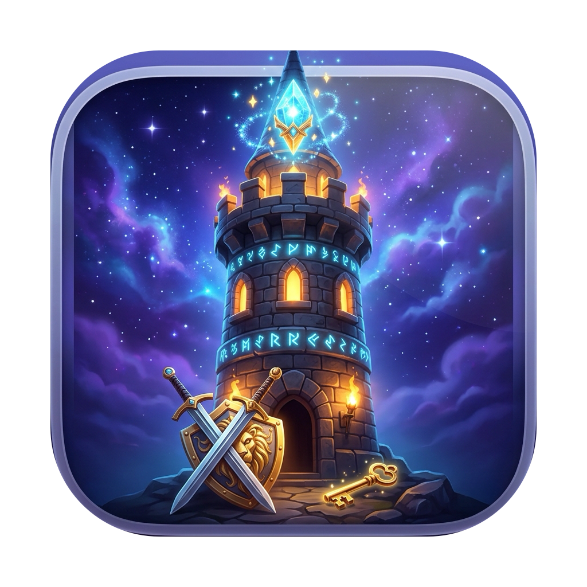

# 🏰 魔塔 · Magic Tower (macOS)

一款基于原生 **Cocoa (`AppKit` + `WKWebView`)** 与 **HTML5 Canvas + WebAudio** 构建的 macOS 像素奇幻策略 RPG 独立游戏。

<p align="center">
  
</p>

## ✨ 游戏特色

- **原生 macOS 应用体验 (`MagicTower.app`)**
  - 原生 macOS 窗口、高清圆角应用图标 (`AppIcon.icns`)、顶部系统菜单栏 (`Menu` & `Cheat!`) 与快捷键支持。
  - 支持本地多槽位持久化存档（`localStorage` + `~/Library/Application Support/MagicTower/latest_save.json` 双重备份）。
- **60 FPS 零卡顿渲染与粒子光影**
  - 14×14 静态地图离屏画布缓存 (`floorCacheCanvas`) + 预渲染径向辉光贴图 (`glowSprites`)。
  - 动态主角火把光照、楼层环境氛围粒子（常规地牢、第 6 层熔岩火海、第 7 层极寒冰窟、第 10 层魔王决战殿堂）、拾取与暴击粒子特效。
- **沉浸式多主题 BGM 与内存级零延迟音效**
  - 内置 5 首场景背景音乐（主界面序曲、地牢探索、熔岩火海、冰封秘境、终焉魔王决战），支持随楼层自动切换或手动点播。
  - 16 种独立合成的 44.1kHz 立体声游戏音效（脚步、拾取钥匙、开门、喝药水、吸收宝石、获得圣物、挥剑命中、暴击、闪避、诅咒、升级号角、商店购买、上下楼梯、发现暗墙、通关胜利、战败），启动时预解码为 WebAudio `AudioBuffer`，连续拾取零延迟无卡顿。
- **回合制战斗动画与【怪物图鉴】探测系统**
  - 支持可视化的回合制交战动画（也可随时勾选/取消“回合动画战斗”切换为秒算模式），战斗结束后自动结算金币、经验与升级加成。
  - 获得绿皮【怪物图鉴】后，鼠标悬停在任意怪物上即可实时探测其生命、攻防、暴击/闪避率及当前战损预测，按 `B` 键可随时打开本层怪物图鉴。

---

## 🎮 操作指南与快捷键

| 按键 / 操作 | 功能说明 |
| :--- | :--- |
| `↑` `↓` `←` `→` / `W` `A` `S` `D` | 控制英雄上、下、左、右移动与交互 |
| **鼠标左键点击相邻格** | 快捷向相邻方向移动一步 |
| **鼠标悬停地图格** | 查看地形、道具说明；获得【怪物图鉴】后可探测怪物属性与预计战损 |
| `B` | 打开 / 关闭当前楼层【怪物图鉴】（需先在塔内拾取图鉴） |
| `M` / `K` | 快速存档（Quick Save） |
| `L` | 快速读档（Quick Load） |
| `H` | 打开 / 关闭游戏帮助 |
| `C` | 打开 / 关闭内置金手指（Cheat!）面板 |
| `N` | 重新开始新游戏 |

---

## 🚀 运行与编译

### 1. 直接运行
仓库已包含编译好的 `MagicTower.app`，在 macOS 下可直接双击运行或通过终端启动：

```bash
open MagicTower.app
```

### 2. 从源码重新编译
如果需要修改原生壳（`src/main.swift`）或重新签名打包，直接执行根目录下的构建脚本：

```bash
./build.sh
```

如果需要重新生成立体声游戏音效与背景音乐（`MagicTower.app/Contents/Resources/assets/audio/`）：

```bash
python3 src/gen_audio.py
```

---

## 📁 目录结构

```text
.
├── MagicTower.app/                  # 可直接运行的 macOS 应用程序包
│   └── Contents/
│       ├── Info.plist               # macOS 应用配置信息
│       ├── MacOS/MagicTower         # 编译后的原生二进制可执行文件
│       └── Resources/
│           ├── AppIcon.icns         # macOS 应用图标
│           ├── index.html           # 游戏 UI 界面与布局
│           ├── game.js              # 游戏核心逻辑、渲染引擎与 WebAudio 音频引擎
│           └── assets/              # 像素贴图与音频资源
├── src/
│   ├── main.swift                   # macOS Cocoa + WKWebView 原生宿主源码
│   └── gen_audio.py                 # 44.1kHz 立体声 BGM 与 SFX 合成脚本
├── AppIconMaster.png                # 1024x1024 应用图标源文件
├── AppIcon.iconset/                 # 多尺寸图标集
└── build.sh                         # 一键编译与签名脚本
```
